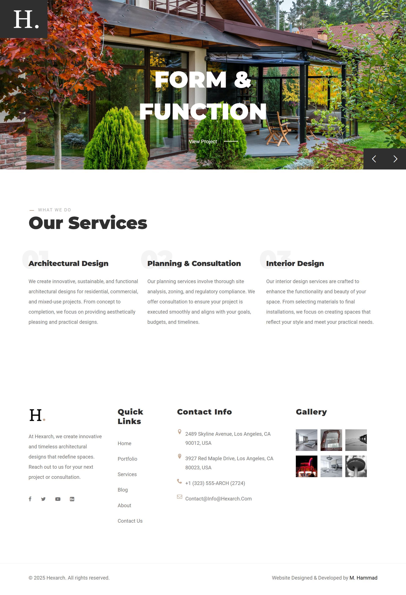
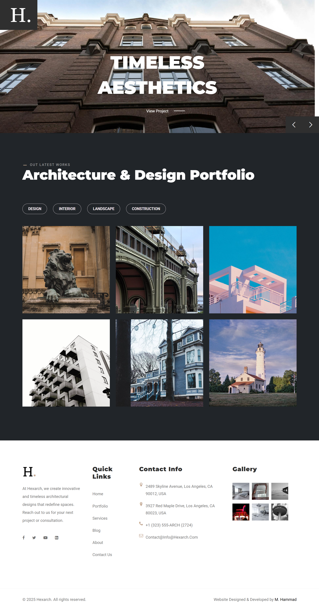
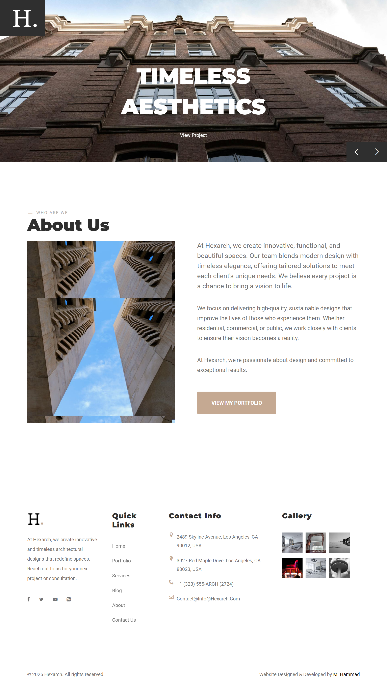
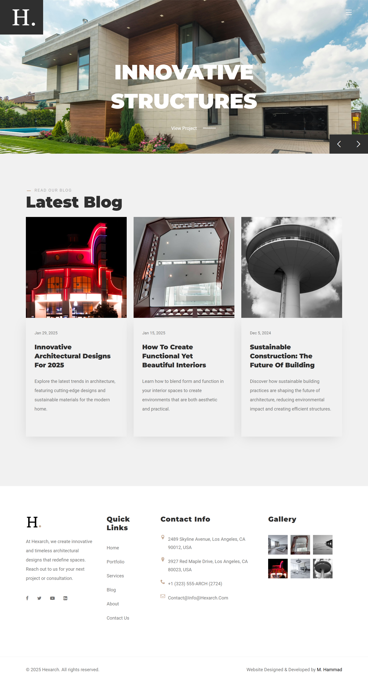
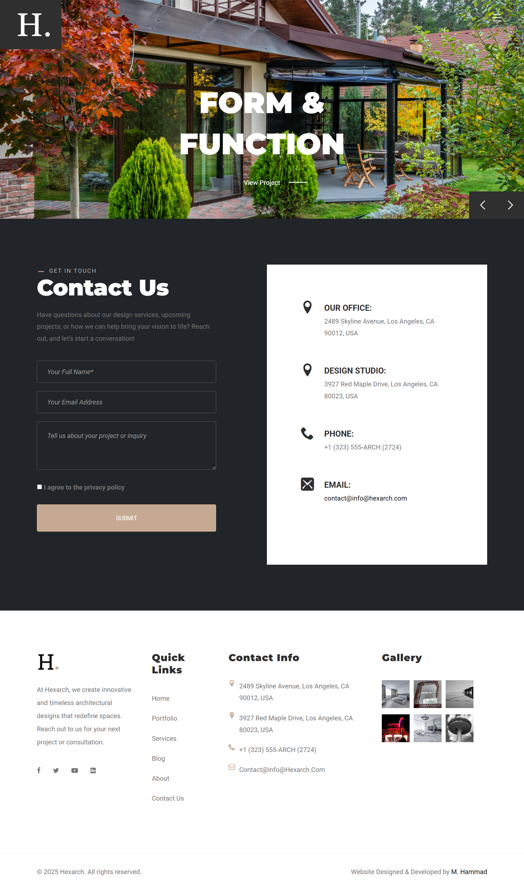

<div align="center">

  

  # HEXARCH
  ### Luxury Architecture, Spatial Planning & Interior Construction Portfolio

  <p align="center">
    A sophisticated, high-performance multi-page architectural studio web application featuring fluid kinetic typography, buttery parallax depth, responsive full-screen overlay navigation, and filterable interactive portfolios.
  </p>

  <p align="center">
    <a href="#-project-overview">Overview</a> •
    <a href="#-visual-showcase">Showcase</a> •
    <a href="#-key-features">Features</a> •
    <a href="#-pages-overview">Pages</a> •
    <a href="#-tech-stack">Tech Stack</a> •
    <a href="#-project-structure">Structure</a> •
    <a href="#-quick-start">Quick Start</a> •
    <a href="#-author">Author</a>
  </p>

  <p align="center">
    
    
    
    
    
    
    
  </p>

</div>

---

## 🏛️ Project Overview

**Hexarch** is a corporate and portfolio web template tailored for architectural studios, structural engineers, interior designers, and luxury urban planners. Built with a minimalist editorial aesthetic, Hexarch marries architectural discipline with high-end digital interactivity.

The design philosophy emphasizes:
- **Clean Geometric Structure**: Monospaced precision paired with editorial typography (`Montserrat` & `Roboto`).
- **Tactile Material Palette**: Architectural taupe/champagne accent (`#C5A992`) set against dark graphite slate (`#2F2F2F`) and warm off-white tones (`#F1F1F0`).
- **Dynamic Spatial Storytelling**: Seamless parallax layers, text-reveal letter transitions, and interactive project galleries.

---

## 📸 Visual Showcase

<div align="center">
  <h3>🖥️ Desktop Experience — Home Showcase</h3>
  
</div>

<br/>

### 📱 Responsive & Multi-Page Previews

| **Architectural Services** | **Project Portfolio** |
|:---:|:---:|
|  |  |
| *Comprehensive architectural capabilities* | *Isotope dynamic category filtering* |

| **Studio Heritage & Philosophy** | **Architectural Journal & Blog** |
|:---:|:---:|
|  |  |
| *Vision, leadership team, and credentials* | *Articles on trends, design, and green builds* |

| **Inquiries & Client Contact** | **Mobile Responsive Experience** |
|:---:|:---:|
|  |  |
| *Consultation booking & studio coordinates* | *Fluid responsiveness across all handhelds* |

---

## ✨ Key Features

- **Cinematic Parallax Hero Slider**: Built using **Jarallax** and **Slick Slider** to deliver multi-layered depth and fluid slide transitions.
- **Kinetic Typography**: Micro-animations powered by **Anime.js** that deconstruct and sequence letterforms upon user interactions.
- **Dynamic Portfolio Filtering**: Integrated with **Isotope Layout Engine** for instantaneous, animated multi-category sorting (Commercial, Residential, Interior, Urban).
- **Chocolat Lightbox Modal**: High-definition image previews allowing clients to inspect architectural renders in full resolution.
- **Full-Screen Overlay Navigation**: Modern minimalist slide-out navigation menu equipped with instant studio contact info and business hours.
- **Client Testimonial Showcase**: Elegant quote slider highlighting client feedback, project briefs, and corporate endorsements.
- **Architectural Journal / Blog Grid**: Structured articles with metadata, reading duration, categorization, and responsive layouts.
- **Contact & Consultation Suite**: Complete inquiry form alongside studio coordinates, office hours, and direct booking channels.
- **Production-Ready & Cross-Browser Tested**: Semantic HTML5 markup, optimized CSS custom properties, and modular JavaScript.

---

## 📑 Pages Overview

| Page | File | Key Highlights |
| :--- | :--- | :--- |
| **Home** | [`index.html`](index.html) | Parallax hero slider, studio introduction, featured project grid, service highlights, newsletter signup, testimonials, and footer gallery. |
| **About** | [`about.html`](about.html) | Company background, design philosophy, leadership architects, milestones, and client satisfaction statistics. |
| **Services** | [`services.html`](services.html) | Architectural planning, interior design, urban planning, 3D visualization, sustainable architecture, and project management. |
| **Portfolio** | [`portfolio.html`](portfolio.html) | Categorized project gallery with live Isotope filtering and high-resolution Chocolat modal inspection. |
| **Blog** | [`latest-blog.html`](latest-blog.html) | Architectural insights, structural design trends, sustainability articles, and pagination layout. |
| **Contact** | [`contact.html`](contact.html) | Consultation inquiry form, studio location details, phone lines, email channels, and business hours. |

---

## 🛠️ Tech Stack & Libraries

<div align="center">

| Layer | Technologies / Libraries | Purpose |
| :--- | :--- | :--- |
| **Core** | `HTML5`, `CSS3 (Custom Properties)`, `JavaScript (ES6+)` | Semantic foundation & clean structural logic |
| **Framework** | `Bootstrap 5.3.1` | Mobile-first grid, responsive utilities, and modals |
| **Layout Engine** | `Isotope Layout v3` | Fluid filtering and animated masonry arrangement |
| **Motion & Parallax**| `Jarallax`, `Anime.js`, `Slick Slider` | Hero parallax layers, kinetic text reveals, carousel |
| **Lightbox** | `Chocolat.js` | Modal zoom, fullscreen inspection of architectural photos |
| **Typography** | `Montserrat` & `Roboto` via Google Fonts | Bold architectural headlines & clean legible body copy |
| **Iconography** | `Icomoon Font` & `FontAwesome 6` | Vector icons for UI navigation and studio metadata |

</div>

---

## 🎨 Design System & Palette

```
/* Primary Theme Color Palette */
Primary Accent (Warm Taupe)   : #C5A992   rgb(197, 169, 146)
Dark Slate / Charcoal         : #2F2F2F   rgb(47, 47, 47)
Light Sand / Background Tint  : #F1F1F0   rgb(241, 241, 240)
Deep Black (Contrast Accents) : #111111   rgb(17, 17, 17)
Body Text Gray                : #757575   rgb(117, 117, 117)
```

- **Headings Font**: `'Montserrat', sans-serif` (Weights: 700, 900)
- **Body Font**: `'Roboto', sans-serif` (Weights: 400, 700)

---

## 📂 Project Structure

```
Hexarch/
│
├── 📄 index.html                  # Main homepage (Hero, Portfolio, Services, Reviews)
├── 📄 about.html                  # Studio profile, leadership, philosophy & stats
├── 📄 services.html               # Service offerings & architectural workflow
├── 📄 portfolio.html              # Filterable architectural showcase gallery
├── 📄 latest-blog.html            # Design journal, articles & architectural trends
├── 📄 contact.html                # Inquiry form, studio map & operating hours
├── 📄 style.css                   # Custom global stylesheet & design system
├── 📄 .gitignore                  # Git ignore configuration for development hygiene
├── 📄 README.md                   # Comprehensive project documentation
│
├── 📁 css/                        # Stylesheet dependencies
│   ├── 📄 vendor.css              # Bundled styles for 3rd-party plugins (Slick, Chocolat)
│   └── 🖼️ ajax-loader.gif         # Async loader asset for UI components
│
├── 📁 js/                         # JavaScript source & libraries
│   ├── 📄 jquery-1.11.0.min.js    # jQuery runtime dependency
│   ├── 📄 plugins.js              # Bundled vendor plugins (Slick, Jarallax, Chocolat)
│   └── 📄 script.js               # Main application scripts (Isotope, Anime.js, slider init)
│
├── 📁 icomoon/                    # Custom icon font package
│   ├── 📁 fonts/                  # Icomoon webfont binaries (.eot, .svg, .ttf, .woff)
│   ├── 📄 icomoon.css             # Vector icon classes & glyph definitions
│   └── 📄 selection.json          # Icomoon project configuration file
│
├── 📁 images/                     # Production visual assets
│   ├── 🖼️ logo.png                # Hexarch studio identity logo
│   ├── 🖼️ main-banner1.jpg        # Hero banner parallax layer 1
│   ├── 🖼️ main-banner2.jpg        # Hero banner parallax layer 2
│   ├── 🖼️ main-banner3.jpg        # Hero banner parallax layer 3
│   ├── 🖼️ portfolio-thumb-*.jpg   # Project portfolio showcase imagery
│   ├── 🖼️ postimg*.jpg            # Blog article cover photos & footer gallery
│   ├── 🖼️ review-bg.jpg           # Parallax backdrop for client testimonials
│   ├── 🖼️ singleimage.jpg         # High-resolution architectural feature render
│   ├── 🖼️ subscribe-image.png     # Newsletter illustration
│   └── 📁 chocolat/               # Lightbox UI control sprites (close, arrows, loader)
│
└── 📁 screenshots/                # Documentation & repository preview images
    ├── 📸 home-desktop.png        # Full-length desktop home view
    ├── 📸 home-mobile.png         # Responsive smartphone portrait view
    ├── 📸 about.png               # About Us studio page preview
    ├── 📸 services.png            # Services capability page preview
    ├── 📸 portfolio.png           # Filterable portfolio gallery preview
    ├── 📸 blog.png                # Architecture journal preview
    └── 📸 contact.png             # Studio contact & consultation preview
```

---

## 🚀 Quick Start

### 1. Clone or Download the Repository
```bash
git clone https://github.com/your-username/Hexarch.git
cd Hexarch
```

### 2. Run Locally

Because **Hexarch** is built using standard web technologies, no heavy build toolchains or compilation steps are needed. You can run it immediately with any of the following options:

#### Option A: Direct Browser Preview
Double-click [`index.html`](index.html) to open the site directly in Chrome, Firefox, Safari, or Edge.

#### Option B: VS Code Live Server (Recommended)
1. Install the [Live Server](https://marketplace.visualstudio.com/items?itemName=ritwickdey.LiveServer) extension in Visual Studio Code.
2. Right-click [`index.html`](index.html) and click **"Open with Live Server"**.
3. The site will launch automatically at `http://127.0.0.1:5500`.

#### Option C: Python HTTP Server
```bash
# Python 3.x
python -m http.server 8000
```
Open `http://localhost:8000` in your web browser.

#### Option D: Node.js `serve`
```bash
npx serve .
```

---

## ⚙️ Customization Guide

### Changing Brand Colors
Update CSS variables in [`style.css`](style.css#L25-L32):
```css
:root {
  --accent-color: #C5A992;   /* Your primary brand accent */
  --dark-color: #2F2F2F;     /* Background & header tone */
  --grey-color: #F1F1F0;     /* Section backgrounds */
}
```

### Updating Studio Information
To update contact numbers, studio address, and operating hours across all pages, edit the `.nav-overlay` block in any of the HTML templates:
```html
<ul class="list-unstyled text-light nav__block-item">
  <li class="menu-item"><i class="icon icon-location me-2"></i>Your Address Here</li>
  <li class="menu-item"><i class="icon icon-phone me-2"></i>+1 (555) 019-2834</li>
  <li class="menu-item"><i class="icon icon-envelope-o me-2"></i>contact@yourdomain.com</li>
</ul>
```

### Adding New Portfolio Projects
1. Add your project image into the `images/` directory.
2. In [`portfolio.html`](portfolio.html) or [`index.html`](index.html), add a new portfolio item inside `.grid`:
```html
<div class="col-md-4 col-sm-6 portfolio-item residential">
  <div class="image-box">
    <a href="images/your-image.jpg" class="image-link" title="Project Name">
      
    </a>
    <div class="portfolio-content">
      <h3 class="portfolio-title">Project Name</h3>
      <span class="portfolio-category">Residential</span>
    </div>
  </div>
</div>
```

---

## 🌐 Browser Compatibility

Hexarch is verified to work across all modern rendering engines:

| Chrome | Firefox | Safari | Edge | Opera |
|:---:|:---:|:---:|:---:|:---:|
|  Latest ✔ | Latest ✔ | Latest ✔ | Latest ✔ | Latest ✔ |

---

## 👨‍💻 Author

Designed & Developed with precision by **M. Hammad**

- **Project Repository**: [Hexarch on GitHub](#)
- **Role**: Frontend Web Developer & UI Designer

---

## 📜 License

This project is licensed under the [MIT License](LICENSE) — feel free to use it for personal and commercial projects with attribution.

<div align="center">
  <sub>Built with architectural elegance & modern web standards. If you found this project helpful, please give it a ⭐ on GitHub!</sub>
</div>
